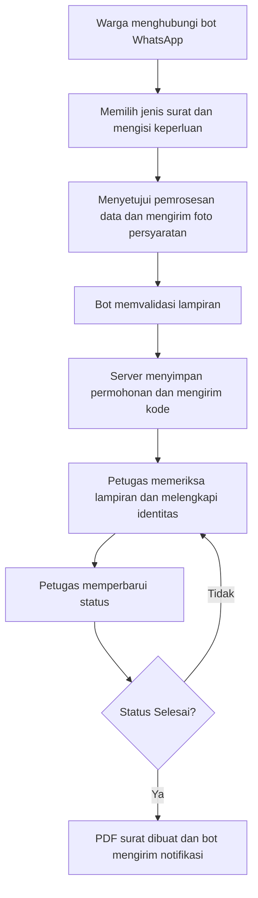

# E-LAYAN Desa Sabah Balau

**Sistem Pengajuan Surat Administrasi Desa Berbasis WhatsApp**


E-LAYAN adalah aplikasi purwarupa (*minimum viable product*) untuk mendigitalkan pelayanan administrasi Desa Sabah Balau, Kecamatan Tanjung Bintang, Kabupaten Lampung Selatan. Warga mengajukan surat melalui percakapan WhatsApp tanpa mengisi formulir web, sedangkan perangkat desa memeriksa permohonan, melengkapi data, dan menerbitkan surat dalam format PDF melalui dashboard web.

## Daftar Isi

- [Gambaran Sistem](#gambaran-sistem)
- [Fitur Utama](#fitur-utama)
- [Teknologi dan Struktur Proyek](#teknologi-dan-struktur-proyek)
- [Menjalankan Aplikasi](#menjalankan-aplikasi)
- [Penggunaan](#penggunaan)
- [API Internal](#api-internal)
- [Keamanan dan Pengelolaan Data](#keamanan-dan-pengelolaan-data)
- [Batasan dan Pengembangan Selanjutnya](#batasan-dan-pengembangan-selanjutnya)
- [Pengembang](#pengembang)

## Gambaran Sistem

Sistem terdiri atas tiga layanan yang dijalankan bersama menggunakan Docker Compose, yaitu basis data PostgreSQL (`db`), server yang melayani dashboard dan API (`app`), serta bot WhatsApp (`bot`). Bot tidak mengakses basis data secara langsung. Seluruh permintaannya melewati API server dengan autentikasi *Bearer token*, sehingga aturan validasi dan keamanan terpusat di satu tempat.

Alurnya dimulai ketika warga menghubungi bot, memilih jenis surat, mengisi keperluan, menyetujui pemrosesan data, dan mengirim foto persyaratan. Server menyimpan permohonan dan memberi warga sebuah kode. Petugas desa kemudian memeriksa lampiran melalui dashboard, melengkapi identitas pemohon, dan memperbarui status. Ketika status menjadi Selesai, surat PDF dapat diterbitkan dan bot memberi tahu warga secara otomatis.



## Fitur Utama

**Bot WhatsApp**

- Menampilkan menu layanan dan memandu pengajuan surat langkah demi langkah.
- Meminta persetujuan warga sebelum data diproses.
- Menerima foto persyaratan dengan kategori `KTP`, `KK`, `RT`, atau `LAINNYA`, lalu memvalidasi jenis dan ukurannya.
- Menyediakan pembatalan sesi dan konfirmasi pengajuan.
- Memeriksa status permohonan berdasarkan kode, serta mengirim notifikasi otomatis ketika status menjadi Selesai.
- Menjawab pertanyaan umum dari FAQ desa. Asisten AI Google Gemini bersifat opsional dan hanya merumuskan jawaban dari isi FAQ tersebut.

**Dashboard web**

- Menampilkan daftar permohonan dengan pencarian dan penyaringan per status, serta detail permohonan beserta lampirannya.
- Memungkinkan petugas mengisi identitas warga, mengubah status dengan catatan, dan melihat riwayat perubahan.
- Membuat dan membuat ulang surat PDF dari template LaTeX untuk keempat jenis surat.
- Mengelola jenis surat, persyaratan dokumen, dan FAQ bot pada halaman pengaturan.

## Teknologi dan Struktur Proyek

| Komponen | Teknologi |
|---|---|
| Bahasa | Go |
| Komunikasi WhatsApp | `whatsmeow` (sesi tertaut disimpan di PostgreSQL sehingga QR tidak perlu dipindai ulang) |
| Asisten AI | Google Gemini API (opsional) |
| Basis data | PostgreSQL |
| Dashboard | Templat HTML dan CSS yang tertanam dalam biner |
| Pembuatan PDF | LaTeX (`pdflatex`, TeX Live) |
| Penyimpanan lampiran | Penyimpanan lokal privat (volume Docker) |
| Penyebaran | Docker dan Docker Compose |

Kode sumber diorganisasi sebagai berikut.

| Direktori | Fungsi |
|---|---|
| `cmd/` | Titik masuk layanan `server` dan `bot`. |
| `config/` | Pembacaan dan validasi konfigurasi dari variabel lingkungan. |
| `internal/app/` | Server HTTP: dashboard, API bot, autentikasi, pengaturan, dan penghapusan data berkala. |
| `internal/handler/` | Alur percakapan dan perutean pesan WhatsApp. |
| `internal/gemini/` | Asisten AI yang dibatasi pada data FAQ. |
| `internal/messenger/` | Abstraksi dan adaptor WhatsApp. |
| `internal/pdf/` | Pembuatan PDF dari template LaTeX per jenis surat. |
| `internal/repository/` | Akses basis data, migrasi, dan penyimpanan sesi bot. |
| `internal/security/` | Hashing dan verifikasi kata sandi administrator. |
| `internal/storage/` | Penyimpanan lampiran privat. |
| `internal/service/` | Notifikasi perubahan status. |
| `internal/client/` | Klien API yang dipakai bot. |
| `internal/domain/` | Model data permohonan, lampiran, FAQ, dan sesi. |
| `pkg/` | Validasi media dan utilitas umum. |
| `db/seed/` | Data contoh FAQ untuk pengujian beserta skrip penghapusnya. |

## Menjalankan Aplikasi

### Kebutuhan

Wajib tersedia [Docker](https://www.docker.com/) beserta Docker Compose, Git, dan sebuah nomor WhatsApp khusus untuk bot. Go, PostgreSQL, dan TeX Live hanya diperlukan apabila aplikasi dijalankan tanpa Docker, karena ketiganya sudah tersedia di dalam image. Kunci API [Google Gemini](https://aistudio.google.com/) bersifat opsional.

### 1. Ambil repositori dan siapkan konfigurasi

```bash
git clone https://github.com/dzhark12/E-LayanBot.git
cd E-LayanBot
cp .env.example .env        # Windows PowerShell: Copy-Item .env.example .env
```

### 2. Isi berkas `.env`

Ganti seluruh nilai contoh, dan jangan memakai kata sandi atau secret bawaan. Aplikasi menolak berjalan apabila variabel wajib kosong atau tidak memenuhi ketentuan berikut.

| Variabel | Ketentuan |
|---|---|
| `POSTGRES_DB`, `POSTGRES_USER`, `POSTGRES_PASSWORD` | Identitas basis data. Kata sandi sebaiknya hanya huruf dan angka agar `DATABASE_URL` tetap valid. |
| `DATABASE_URL` | Host harus `db` (nama layanan PostgreSQL di Docker Compose), bukan `localhost`. |
| `BOT_API_TOKEN` | Token acak, minimal 32 karakter, dipakai bot untuk mengakses API. |
| `WA_HASH_KEY` | Secret acak, minimal 32 karakter, untuk meng-*hash* nomor WhatsApp. Jangan diganti selama data lama masih dipakai, karena nomor yang telah di-*hash* tidak akan cocok lagi. |
| `ADMIN_USERNAME`, `ADMIN_PASSWORD` | Akun administrator dashboard. Kata sandi minimal 12 karakter. |
| `ADMIN_RECOVERY_CODE` | Opsional, minimal 32 karakter. Bila diisi, mengaktifkan pengaturan ulang kata sandi di halaman login. |
| `ATTACHMENT_RETENTION_DAYS` | Lama penyimpanan lampiran (1–3650 hari), ditetapkan sesuai kebijakan yang disepakati dengan pemerintah desa. |
| `SESSION_COOKIE_SECURE` | `true` bila dashboard diakses melalui HTTPS. |
| `HTTP_PORT` | Port dashboard pada komputer host (bawaan 8080). |
| `GEMINI_API_KEY` | Opsional. Bila kosong, bot tetap berjalan dan hanya menjawab dari FAQ. |
| `GEMINI_MODEL`, `GEMINI_MAX_PER_HOUR` | Model Gemini dan batas pemanggilan per jam (1–200, bawaan 10). |
| `VILLAGE_NAME` | Nama desa yang ditampilkan bot. |

### 3. Jalankan layanan

```bash
docker compose up --build -d
```

Pembangunan pertama memakan waktu lebih lama karena image memasang TeX Live. Setelah itu, pada penggunaan pertama tampilkan log bot dan pindai kode QR melalui menu **Perangkat tertaut** di WhatsApp.

```bash
docker compose logs -f bot
```

### 4. Buka dashboard

Buka `http://localhost:8080` (atau port pada `HTTP_PORT`) dan masuk dengan akun administrator dari `.env`.

### 5. Menghentikan layanan

```bash
docker compose down
```

Perintah ini mempertahankan volume. Hindari opsi `-v` selama basis data dan lampiran masih dibutuhkan, karena opsi tersebut menghapus keduanya.

## Penggunaan

### Perintah bot

| Perintah | Fungsi |
|---|---|
| `MENU` | Menampilkan menu layanan. |
| `SURAT` | Memulai pengajuan surat. |
| `BATAL` | Membatalkan sesi pengajuan. |
| `SELESAI` | Menandai pengiriman foto persyaratan telah lengkap. |
| `INFO <pertanyaan>` | Mengajukan pertanyaan umum yang dijawab dari FAQ. |
| Kode permohonan | Memeriksa status pengajuan. |

Sesi percakapan dan foto sementara kedaluwarsa setelah 24 jam.

### Jenis surat

| Kode | Surat | Persyaratan awal |
|---|---|---|
| `DM` | Surat Keterangan Domisili | KTP pemohon, KK, surat pengantar RT |
| `SU` | Surat Keterangan Usaha | KTP pemohon, KK, surat pengantar RT |
| `TM` | Surat Keterangan Tidak Mampu | KTP pemohon, KK, surat pengantar RT |
| `KM` | Surat Keterangan Kematian | KTP almarhum, KK almarhum, surat pengantar RT, KTP pelapor |

Nama dan persyaratan setiap jenis dapat diubah melalui dashboard. Kode di atas tidak menggantikan penetapan nomenklatur resmi oleh pemerintah desa.

### Pemrosesan oleh petugas

1. Petugas membuka permohonan dari dashboard dan memeriksa foto persyaratan.
2. Petugas mengisi identitas pemohon: nama, tempat dan tanggal lahir, jenis kelamin, agama, NIK, pekerjaan, dan alamat, serta penandatangan surat.
3. Petugas mengubah status permohonan. Status Ditolak dan Diperbaiki wajib disertai catatan untuk warga.
4. Setelah status Selesai dan data surat lengkap, PDF dapat diunduh. Surat dibuat dari template pada `internal/pdf/templates/` dan dapat dibuat ulang bila data diperbaiki.

## API Internal

API digunakan untuk komunikasi antara bot dan server. Seluruh endpoint bot mewajibkan header `Authorization: Bearer <BOT_API_TOKEN>`.

| Endpoint | Fungsi |
|---|---|
| `POST /api/v1/submissions` | Membuat permohonan beserta lampiran (`multipart/form-data`). |
| `GET /api/v1/letter-types` | Mengambil jenis surat dan persyaratannya. |
| `GET /api/v1/faq` | Mengambil data FAQ. |
| `POST /api/v1/status` | Memeriksa status berdasarkan kode permohonan dan nomor pemohon. |
| `GET /healthz` | Pemeriksaan kesehatan layanan (tanpa token). |

Permintaan pembuatan permohonan memuat bidang berikut.

| Bidang | Keterangan |
|---|---|
| `request_id` | UUID untuk mencegah pengajuan ganda ketika permintaan dikirim ulang. |
| `letter_code` | Kode jenis surat. |
| `wa_jid` | Identitas WhatsApp pemohon untuk komunikasi. |
| `summary` | Ringkasan keperluan surat. |
| `consent_version` | Versi persetujuan, saat ini `v1`. |
| `attachments`, `attachment_types` | Foto persyaratan beserta kategorinya. |

Ketentuan lampiran: paling banyak lima foto per pengajuan, berformat JPEG atau PNG, masing-masing paling besar 10 MB. Jenis dan ukuran file divalidasi sebelum disimpan.

## Keamanan dan Pengelolaan Data

Karena sistem memproses identitas dan dokumen kependudukan warga, keamanan dirancang sebagai bagian dasar dari aplikasi.

**Perlindungan yang tersedia**

- Dashboard dilindungi autentikasi administrator dengan kata sandi ter-*hash* (PBKDF2), proteksi CSRF, kebijakan keamanan konten (CSP), dan pembatasan percobaan masuk (8 kali per 15 menit per alamat dan nama pengguna).
- Komunikasi bot dan server memakai *Bearer token*.
- Lampiran disimpan pada volume privat dan hanya dapat dibuka melalui dashboard setelah login.
- Nomor WhatsApp pemohon dicocokkan melalui HMAC pada pemeriksaan status, yang dibatasi sepuluh kali per jam per nomor.
- Jawaban asisten AI disaring agar tidak memuat NIK atau nomor telepon, dan hanya bersumber dari FAQ.
- Pembuatan PDF berjalan tanpa `shell-escape`, dan isian pengguna di-*escape* sebelum masuk ke template LaTeX.
- Lampiran permohonan yang telah selesai dihapus otomatis setelah masa retensi berakhir.

**Hal yang perlu dijaga pengelola**

1. Jangan memasukkan `.env`, kata sandi, token, atau secret ke repositori publik.
2. Jangan membagikan QR pairing atau log yang memuat data sensitif, karena QR dapat memberi akses ke sesi WhatsApp tertaut.
3. Jangan membuka direktori lampiran langsung ke internet, dan batasi akses dashboard bagi petugas berwenang.
4. Konfigurasi Docker lokal tidak dengan sendirinya aman untuk penggunaan publik. Pada server, akses dashboard sebaiknya hanya melalui *reverse proxy* HTTPS dengan `SESSION_COOKIE_SECURE=true`.
5. Buat cadangan basis data dan lampiran, serta uji pemulihannya secara berkala.

## Batasan dan Pengembangan Selanjutnya

Pada tahap MVP, fokus sistem adalah mempermudah pengajuan melalui WhatsApp, membantu petugas mengelola permohonan, dan menjaga dokumen warga tetap privat. Penggunaan operasional yang luas masih menunggu verifikasi fitur, konfigurasi keamanan, penetapan prosedur desa, dan pengujian menyeluruh.

**Batasan saat ini**

- Nama, persyaratan, dan template setiap jenis surat perlu disahkan oleh pemerintah desa.
- Identitas pemohon masih diisi manual oleh petugas.
- Jawaban asisten AI bergantung pada kualitas FAQ dan perlu dipantau agar tetap akurat.
- Integrasi `whatsmeow` bukan API resmi WhatsApp, sehingga stabilitas sesinya harus diawasi.
- Pencadangan terjadwal dan statistik evaluasi SDGs belum tersedia.

**Pengembangan selanjutnya**

- Menyesuaikan template PDF dengan format surat yang telah disahkan.
- Menambahkan pencadangan otomatis dan pengujian pemulihan data.
- Menyiapkan server tetap dengan domain, HTTPS, dan pemantauan operasional.
- Menetapkan akun petugas, kebijakan retensi, serta prosedur pengelolaan data warga.
- Menambahkan statistik layanan yang relevan dengan indikator SDGs Desa (16.6.2).

## Pengembang

Dikembangkan oleh **Kelompok 2** pada mata kuliah **Kapita Selekta Informatika (IF25-41031)**, Program Studi Teknik Informatika, Fakultas Teknologi Industri, **Institut Teknologi Sumatera**, sebagai projek berorientasi pencapaian SDGs Desa.

| NIM | Nama | Peran |
|---|---|---|
| 124140217 | Erhan Kurniawan | Project Manager |
| 124140077 | Dzaky Faris Al Faqih | Software Tester |
| 124140079 | Aditya Kristian Novalino | Backend Developer |
| 124140083 | Feldy | Frontend Developer |
| 124140073 | Jhon Kevin H. Tambun | Backend Developer |
| 124140067 | Yabes Situmorang | UI/UX Design |

---

<p align="center">
  <sub>E-LAYAN Desa Sabah Balau · Kelompok 2 · Kapita Selekta Informatika (IF25-41031)<br>
  Program Studi Teknik Informatika · Institut Teknologi Sumatera · 2026</sub>
</p>
