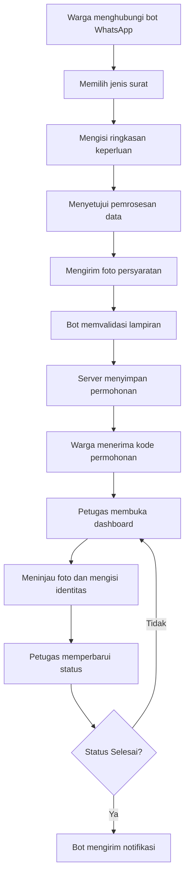

# E-LAYAN Desa Sabah Balau

**Sistem Pengajuan Surat Administrasi Desa Berbasis WhatsApp**


E-LAYAN merupakan aplikasi MVP digitalisasi pelayanan administrasi Desa Sabah Balau. Warga mengajukan surat melalui bot WhatsApp tanpa perlu mengisi formulir web, sedangkan perangkat desa memproses permohonan melalui dashboard web.

## Daftar Isi

- [Fitur Utama](#fitur-utama)
- [Alur Sistem](#alur-sistem)
- [Teknologi](#teknologi)
- [Struktur Folder](#struktur-folder)
- [Persyaratan](#persyaratan)
- [Instalasi dan Menjalankan Aplikasi](#instalasi-dan-menjalankan-aplikasi)
- [Alur Pengajuan Surat](#alur-pengajuan-surat)
- [API Internal](#api-internal)
- [Penyimpanan dan Keamanan Data](#penyimpanan-dan-keamanan-data)
- [Batasan MVP dan Pengembangan Selanjutnya](#batasan-mvp-dan-pengembangan-selanjutnya)

## Fitur Utama

### 1. Bot WhatsApp
- Menampilkan menu layanan administrasi desa.
- Memandu warga memilih jenis surat, menjelaskan keperluan, dan menyetujui pemrosesan data.
- Menerima foto persyaratan dengan kategori `KTP`, `KK`, `RT`, atau `LAINNYA`.
- Menyediakan konfirmasi pengajuan dan pembatalan sesi.
- Memungkinkan warga memeriksa status pengajuan melalui kode permohonan.
- Mengirimkan notifikasi otomatis ketika status permohonan berubah menjadi `Selesai`.
- Menjawab pertanyaan umum berdasarkan FAQ, dengan dukungan asisten AI Google Gemini (opsional).

### 2. Dashboard Web
- Menampilkan daftar dan detail pengajuan beserta lampirannya.
- Memungkinkan petugas mengisi identitas warga secara manual.
- Memungkinkan petugas memperbarui status dan melihat riwayat perubahan.
- Membuat surat dalam format PDF berdasarkan template LaTeX.
- Menyediakan pengaturan FAQ, jenis surat, dan persyaratan melalui halaman `/settings`.

Fitur keamanan dan pengelolaan data dijelaskan pada bagian [Penyimpanan dan Keamanan Data](#penyimpanan-dan-keamanan-data).

## Alur Sistem



## Teknologi

| Komponen | Teknologi |
|---|---|
| Bahasa pemrograman | Go |
| Komunikasi WhatsApp | `whatsmeow` |
| Asisten AI | Google Gemini API (opsional) |
| Pembuatan PDF | LaTeX (`pdflatex`, TeX Live) |
| Backend | HTTP API berbasis Go |
| Dashboard | HTML, CSS, dan template Go |
| Database | PostgreSQL |
| Penyimpanan lampiran | Local storage privat |
| Deployment | Docker dan Docker Compose |
| Autentikasi internal | Bearer token |
| Identitas permohonan | UUID |

## Struktur Folder

```text
E-LayanBot/
├── cmd/
│   ├── bot/
│   │   └── main.go
│   └── server/
│       └── main.go
├── config/
│   └── config.go
├── docs/
│   └── flowchart_bot.png
├── internal/
│   ├── app/
│   │   ├── assets.go
│   │   ├── auth.go
│   │   ├── bot.go
│   │   ├── bot_api.go
│   │   ├── dashboard.go
│   │   ├── letter.go
│   │   ├── retention.go
│   │   ├── server.go
│   │   ├── settings.go
│   │   ├── submissions.go
│   │   ├── static/
│   │   └── templates/
│   ├── client/
│   │   ├── backend_client.go
│   │   └── storage_client.go
│   ├── domain/
│   ├── gemini/
│   │   ├── assistant.go
│   │   └── client.go
│   ├── handler/
│   │   ├── router.go
│   │   ├── menu_handler.go
│   │   ├── surat_handler.go
│   │   ├── faq_handler.go
│   │   └── status_handler.go
│   ├── id/
│   │   └── uuid.go
│   ├── messenger/
│   │   ├── messenger.go
│   │   ├── whatsmeow/
│   │   │   └── adapter.go
│   │   └── cloudapi/
│   │       └── adapter.go
│   ├── pdf/
│   │   ├── pdf.go
│   │   └── templates/
│   ├── repository/
│   │   ├── postgres.go
│   │   ├── sesi_repository.go
│   │   └── migrations/
│   ├── security/
│   │   └── password.go
│   ├── service/
│   │   ├── notifier_service.go
│   │   ├── surat_service.go
│   │   ├── faq_service.go
│   │   └── status_service.go
│   └── storage/
│       └── local.go
├── pkg/
│   ├── utils/
│   │   └── parser.go
│   └── validator/
│       └── media_validator.go
├── Dockerfile
├── docker-compose.yml
├── .env.example
├── go.mod
├── go.sum
├── .dockerignore
├── .gitignore
└── README.md
```

### Ringkasan Direktori

| Direktori | Fungsi |
|---|---|
| `cmd/` | Entry point untuk service bot dan server. |
| `config/` | Membaca konfigurasi aplikasi dari environment. |
| `docs/` | Dokumentasi dan diagram sistem. |
| `internal/app/` | Routing HTTP, API, autentikasi, dashboard, dan pengaturan. |
| `internal/client/` | Klien komunikasi bot dengan backend dan layanan penyimpanan. |
| `internal/domain/` | Model data FAQ, lampiran, permohonan, dan sesi bot. |
| `internal/gemini/` | Klien Google Gemini dan asisten AI untuk menjawab pertanyaan warga. |
| `internal/handler/` | Routing pesan dan alur percakapan WhatsApp. |
| `internal/messenger/` | Abstraksi dan adapter integrasi WhatsApp. |
| `internal/pdf/` | Pembuatan PDF surat dari template LaTeX (kop desa, logo, dan template per jenis surat). |
| `internal/repository/` | Akses database, migrasi, dan penyimpanan sesi. |
| `internal/security/` | Hashing dan verifikasi password administrator. |
| `internal/service/` | Logika layanan, termasuk notifikasi perubahan status. |
| `internal/storage/` | Penyimpanan lampiran secara privat. |
| `pkg/` | Utilitas dan validasi media yang dapat digunakan lintas paket. |

> Catatan: beberapa file masih berupa placeholder, yaitu `menu_handler.go`, `surat_handler.go`, `faq_handler.go`, dan `status_handler.go` pada `internal/handler/`, `storage_client.go`, `faq_service.go`, `surat_service.go`, `status_service.go`, serta adapter `cloudapi`. Logika percakapan saat ini berada di `internal/handler/router.go`.

## Persyaratan

Wajib:

- [Docker](https://www.docker.com/) dan Docker Compose.
- Git untuk mengambil repository.
- Akun WhatsApp khusus untuk pilot bot.

Opsional:

- API key [Google Gemini](https://aistudio.google.com/) untuk mengaktifkan asisten AI.
- [Go](https://go.dev/dl/) sesuai versi pada `go.mod`, PostgreSQL, dan TeX Live, hanya apabila aplikasi dijalankan tanpa Docker. Ketiganya sudah tersedia di dalam image Docker.

## Instalasi dan Menjalankan Aplikasi

### 1. Clone repository

```bash
git clone https://github.com/dzhark12/E-LayanBot.git
cd E-LayanBot
```

### 2. Siapkan konfigurasi environment

Salin file konfigurasi contoh menjadi `.env`.

Linux/macOS:

```bash
cp .env.example .env
```

Windows PowerShell:

```powershell
Copy-Item .env.example .env
```

### 3. Konfigurasikan secret dan retensi

Ganti seluruh nilai contoh pada `.env`. Jangan menggunakan password atau secret bawaan untuk deployment.

- Gunakan password database yang kuat (disarankan hanya huruf dan angka agar `DATABASE_URL` tetap valid).
- Pastikan host pada `DATABASE_URL` adalah `db` (nama service PostgreSQL di Docker Compose), bukan `localhost`.
- Isi `BOT_API_TOKEN` dengan token acak minimal 32 karakter.
- Tetapkan `WA_HASH_KEY` dengan secret acak minimal 32 karakter yang stabil.
- Atur `ADMIN_USERNAME` dan `ADMIN_PASSWORD` (minimal 12 karakter).
- Tentukan `ATTACHMENT_RETENTION_DAYS` (1–3650) berdasarkan keputusan retensi yang disetujui oleh pihak desa.
- Isi `GEMINI_API_KEY` apabila asisten AI ingin diaktifkan. Jika dikosongkan, bot tetap berjalan dan hanya menjawab berdasarkan FAQ.
- Pastikan konfigurasi cookie sesuai dengan lingkungan deployment.

Aplikasi akan menolak berjalan apabila variabel wajib kosong atau tidak memenuhi panjang minimum di atas.

Jangan mengubah `WA_HASH_KEY` ketika data yang bergantung pada kunci tersebut masih digunakan. Perubahan kunci dapat menyebabkan data yang sebelumnya di-hash tidak lagi dapat dicocokkan.

### 4. Jalankan aplikasi

Dari direktori utama repository, jalankan:

```bash
docker compose up --build
```

Perintah tersebut membangun dan menjalankan tiga service, yaitu `db` (PostgreSQL), `app` (server dan dashboard), dan `bot` (bot WhatsApp). Proses build pertama memerlukan waktu lebih lama karena image memasang TeX Live untuk pembuatan PDF.

### 5. Hubungkan WhatsApp

Pada penggunaan pertama, buka log service bot:

```bash
docker compose logs -f bot
```

Pindai QR pairing yang ditampilkan melalui WhatsApp pada menu **Perangkat tertaut**.

### 6. Buka dashboard

Akses dashboard melalui browser:

```text
http://localhost:8080
```

Masuk menggunakan kredensial administrator yang telah dikonfigurasi di `.env`.

Untuk menghentikan service, gunakan:

```bash
docker compose down
```

Perintah tersebut tidak menghapus volume secara otomatis. Hindari menjalankan `docker compose down -v` jika masih membutuhkan data database atau lampiran yang tersimpan pada volume Docker.

## Alur Pengajuan Surat

### 1. Percakapan WhatsApp

Bot menyediakan alur percakapan dengan perintah berikut:

| Perintah | Fungsi |
|---|---|
| `MENU` | Menampilkan menu layanan. |
| `SURAT` | Memulai alur pengajuan surat. |
| `BATAL` | Membatalkan sesi pengajuan. |
| `SELESAI` | Mengonfirmasi penyelesaian pengiriman persyaratan. |
| `INFO <pertanyaan>` | Mengajukan pertanyaan umum yang dijawab dari FAQ atau asisten AI. |
| Kode permohonan | Mengirim kode permohonan untuk memeriksa status pengajuan. |

Sesi percakapan dan foto sementara memiliki masa kedaluwarsa 24 jam.

### 2. Jenis surat

Kode jenis surat awal yang tersedia:

| Kode | Keterangan | Persyaratan awal |
|---|---|---|
| `DM` | Surat Keterangan Domisili | KTP pemohon, KK, surat pengantar RT |
| `SU` | Surat Keterangan Usaha | KTP pemohon, KK, surat pengantar RT |
| `TM` | Surat Keterangan Tidak Mampu | KTP pemohon, KK, surat pengantar RT |
| `KM` | Surat Keterangan Kematian | KTP almarhum, KK almarhum, surat pengantar RT, KTP pelapor |

Nama, persyaratan, dan informasi setiap jenis surat dapat dikelola melalui dashboard. Kode di atas tidak menggantikan penetapan nomenklatur resmi oleh pemerintah desa.

### 3. Pemrosesan oleh petugas

Petugas meninjau permohonan dan lampiran melalui dashboard, kemudian mengisi identitas warga secara manual, meliputi nama, tempat dan tanggal lahir, jenis kelamin, agama, NIK, pekerjaan, dan alamat.

Setelah identitas lengkap, petugas dapat membuat atau membuat ulang PDF surat melalui halaman detail permohonan. PDF dibuat dari template LaTeX pada `internal/pdf/templates/`.

## API Internal

API internal digunakan untuk komunikasi antara bot WhatsApp dan server. Seluruh endpoint bot menggunakan autentikasi Bearer token:

```http
Authorization: Bearer <BOT_API_TOKEN>
```

### Endpoint utama

| Endpoint | Fungsi |
|---|---|
| `POST /api/v1/submissions` | Membuat permohonan beserta lampiran. |
| `GET /api/v1/letter-types` | Mengambil jenis surat dan persyaratannya. |
| `GET /api/v1/faq` | Mengambil data FAQ yang tersedia. |
| `POST /api/v1/status` | Memeriksa status permohonan berdasarkan kode dan nomor pemohon. |

Selain itu, server menyediakan `GET /healthz` untuk pemeriksaan kesehatan service.

### Membuat permohonan

`POST /api/v1/submissions` menerima request dengan format `multipart/form-data`.

| Field | Keterangan |
|---|---|
| `request_id` | UUID untuk idempotensi, mencegah pengajuan ganda ketika request dikirim ulang. |
| `letter_code` | Kode jenis surat. |
| `wa_jid` | Identitas WhatsApp pemohon untuk komunikasi. |
| `summary` | Ringkasan keperluan surat. |
| `consent_version` | Versi persetujuan, saat ini `v1`. |
| `attachments` | File foto persyaratan. |
| `attachment_types` | Kategori masing-masing lampiran. |

Ketentuan lampiran:

- Maksimal lima foto dalam satu pengajuan.
- Format JPEG atau PNG dengan ukuran maksimal 10 MB per foto.
- Tipe dan ukuran file divalidasi sebelum disimpan.

## Penyimpanan dan Keamanan Data

Karena aplikasi memproses data identitas warga dan dokumen administrasi, keamanan perlu menjadi bagian utama dari operasional sistem.

### Data dan penyimpanan

- Dashboard dilindungi autentikasi administrator, sedangkan komunikasi bot dan server menggunakan Bearer token.
- Lampiran disimpan pada storage lokal privat (volume Docker) dan hanya dapat diakses melalui dashboard setelah login.
- JID WhatsApp digunakan untuk kebutuhan komunikasi dan notifikasi.
- HMAC nomor digunakan untuk pencocokan pada proses pemeriksaan status.
- Permintaan pemeriksaan status dibatasi hingga sepuluh kali per jam per nomor.
- Lampiran permohonan yang telah selesai dihapus berdasarkan masa retensi yang disetujui.

### Hal yang perlu dijaga

1. Jangan memasukkan `.env`, password, token, atau secret ke repository publik.
2. Jangan membuka direktori lampiran secara langsung ke internet.
3. Batasi akses dashboard kepada petugas yang berwenang.
4. Untuk penggunaan di server, akses dashboard hanya melalui domain dengan reverse proxy HTTPS dan atur `SESSION_COOKIE_SECURE=true`. Konfigurasi lokal Docker tidak dengan sendirinya menjamin keamanan deployment publik.
5. Jangan membagikan QR pairing atau log yang mengandung data sensitif, karena QR dapat memberikan akses ke sesi WhatsApp yang ditautkan.
6. Siapkan mekanisme backup dan uji pemulihan data secara berkala.

## Batasan MVP dan Pengembangan Selanjutnya

Fokus tahap awal E-LAYAN adalah mempermudah pengajuan melalui WhatsApp, membantu petugas mengelola permohonan melalui dashboard, dan menjaga dokumen warga tetap privat. Penggunaan operasional secara luas perlu menunggu verifikasi fitur, konfigurasi keamanan, penetapan prosedur desa, serta pengujian sistem secara menyeluruh.

### Batasan saat ini

- Nama, persyaratan, dan template PDF setiap jenis surat masih perlu diverifikasi dan disahkan oleh pemerintah desa.
- Pengisian identitas warga masih dilakukan secara manual oleh petugas.
- Jawaban asisten AI bergantung pada kualitas data FAQ dan perlu dipantau agar tetap akurat.
- Integrasi WhatsApp menggunakan `whatsmeow` untuk kebutuhan pilot dan memerlukan pemantauan stabilitas sesi.
- Backup terjadwal dan statistik evaluasi SDGs belum dikonfigurasi.
- Beberapa modul masih berupa placeholder (lihat [Struktur Folder](#struktur-folder)).

### Pengembangan selanjutnya

- Menyesuaikan persyaratan dan template PDF dengan format surat yang telah disahkan.
- Menyelesaikan modul yang masih berupa placeholder jika diperlukan.
- Menambahkan backup otomatis dan pengujian pemulihan data.
- Menyiapkan domain, HTTPS, hosting, dan monitoring operasional.
- Menetapkan akun petugas, kebijakan retensi, serta prosedur pengelolaan data warga.
- Menambahkan statistik layanan dan indikator evaluasi yang relevan dengan SDGs.
