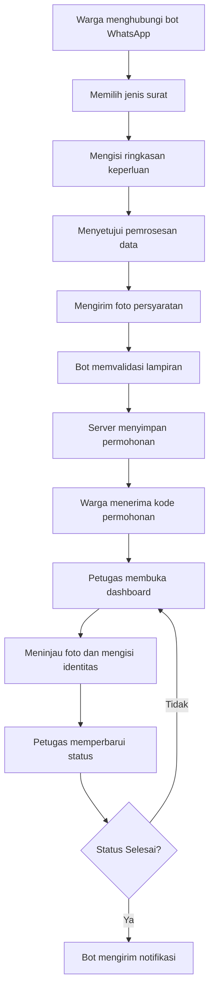

# E-LAYAN Desa Sabah Balau

**Sistem Pengajuan Surat Administrasi Desa Berbasis WhatsApp**

E-LAYAN merupakan aplikasi MVP untuk mempermudah warga Desa Sabah Balau dalam mengajukan surat administrasi melalui WhatsApp. Warga dapat memilih jenis surat, menjelaskan keperluan, menyetujui pemrosesan data, dan mengirimkan foto dokumen persyaratan tanpa harus memulai proses melalui formulir web.

Perangkat desa mengelola permohonan melalui dashboard web yang menyediakan fitur pemantauan pengajuan, peninjauan lampiran secara privat, pengisian identitas warga secara manual, pembaruan status, dan pengelolaan informasi layanan.

## Daftar Isi

- [Fitur Utama](#fitur-utama)
- [Alur Sistem](#alur-sistem)
- [Teknologi](#teknologi)
- [Struktur Folder](#struktur-folder)
- [Persyaratan](#persyaratan)
- [Instalasi dan Menjalankan Aplikasi](#instalasi-dan-menjalankan-aplikasi)
- [Alur Pengajuan Surat](#alur-pengajuan-surat)
- [API Internal](#api-internal)
- [Penyimpanan dan Keamanan Data](#penyimpanan-dan-keamanan-data)
- [Batasan MVP dan Pengembangan Selanjutnya](#batasan-mvp-dan-pengembangan-selanjutnya)

## Fitur Utama

### 1. Bot WhatsApp
- Menampilkan menu layanan administrasi desa.
- Memungkinkan warga memilih jenis surat dan menjelaskan keperluan.
- Meminta persetujuan pemrosesan data sebelum pengiriman dokumen.
- Menerima foto persyaratan dengan kategori `KTP`, `KK`, `RT`, atau `LAINNYA`.
- Menyediakan konfirmasi pengajuan dan pembatalan sesi.
- Memungkinkan warga memeriksa status pengajuan melalui kode permohonan.
- Mengirimkan notifikasi otomatis ketika status permohonan berubah menjadi `Selesai`.
- Menjawab pertanyaan umum berdasarkan FAQ yang dikelola administrator.

### 2. Dashboard Web
- Menampilkan daftar dan detail pengajuan surat.
- Menampilkan lampiran secara privat setelah administrator berhasil login.
- Memungkinkan petugas mengisi identitas warga secara manual.
- Memungkinkan petugas memperbarui status dan melihat riwayat perubahan.
- Menyediakan pengaturan FAQ, jenis surat, dan persyaratan melalui halaman `/settings`.

### 3. Keamanan dan Pengelolaan Data
- Autentikasi administrator pada dashboard.
- Autentikasi token untuk komunikasi internal antara bot dan server.
- Penyimpanan foto pada direktori privat.
- Validasi tipe dan ukuran file lampiran.
- Pencegahan pengajuan duplikat menggunakan UUID idempotensi.
- Pembatasan permintaan pengecekan status.
- Penghapusan lampiran berdasarkan masa retensi yang telah disetujui.

## Alur Sistem



## Teknologi

| Komponen | Teknologi |
|---|---|
| Bahasa pemrograman | Go |
| Komunikasi WhatsApp | `whatsmeow` |
| Backend | HTTP API berbasis Go |
| Dashboard | HTML, CSS, dan template Go |
| Database | PostgreSQL |
| Penyimpanan lampiran | Local storage privat |
| Deployment | Docker dan Docker Compose |
| Autentikasi internal | Bearer token |
| Identitas permohonan | UUID |

## Struktur Folder

```text
E-LayanBot/
├── cmd/
│   ├── bot/
│   │   └── main.go
│   └── server/
│       └── main.go
├── config/
│   └── config.go
├── docs/
│   └── flowchart_bot.png
├── internal/
│   ├── app/
│   │   ├── assets.go
│   │   ├── auth.go
│   │   ├── bot.go
│   │   ├── bot_api.go
│   │   ├── dashboard.go
│   │   ├── retention.go
│   │   ├── server.go
│   │   ├── settings.go
│   │   ├── submissions.go
│   │   ├── static/
│   │   └── templates/
│   ├── client/
│   │   ├── backend_client.go
│   │   └── storage_client.go
│   ├── domain/
│   ├── handler/
│   │   ├── router.go
│   │   ├── menu_handler.go
│   │   ├── surat_handler.go
│   │   ├── faq_handler.go
│   │   └── status_handler.go
│   ├── id/
│   │   └── uuid.go
│   ├── messenger/
│   │   ├── messenger.go
│   │   ├── whatsmeow/
│   │   │   └── adapter.go
│   │   └── cloudapi/
│   │       └── adapter.go
│   ├── repository/
│   │   ├── postgres.go
│   │   ├── sesi_repository.go
│   │   └── migrations/
│   ├── security/
│   │   └── password.go
│   ├── service/
│   │   ├── notifier_service.go
│   │   ├── surat_service.go
│   │   ├── faq_service.go
│   │   └── status_service.go
│   └── storage/
│       └── local.go
├── pkg/
│   ├── utils/
│   │   └── parser.go
│   └── validator/
│       └── media_validator.go
├── Dockerfile
├── docker-compose.yml
├── go.mod
├── go.sum
├── .dockerignore
├── .gitignore
└── README.md
```

### Ringkasan Direktori

| Direktori | Fungsi |
|---|---|
| `cmd/` | Entry point untuk service bot dan server. |
| `config/` | Membaca konfigurasi aplikasi dari environment. |
| `docs/` | Dokumentasi dan diagram sistem. |
| `internal/app/` | Routing HTTP, API, autentikasi, dashboard, dan pengaturan. |
| `internal/client/` | Klien komunikasi bot dengan backend dan layanan penyimpanan. |
| `internal/domain/` | Model data FAQ, lampiran, permohonan, dan sesi bot. |
| `internal/handler/` | Routing pesan dan alur percakapan WhatsApp. |
| `internal/messenger/` | Abstraksi dan adapter integrasi WhatsApp. |
| `internal/repository/` | Akses database, migrasi, dan penyimpanan sesi. |
| `internal/security/` | Hashing dan verifikasi password administrator. |
| `internal/service/` | Logika layanan, termasuk notifikasi perubahan status. |
| `internal/storage/` | Penyimpanan lampiran secara privat. |
| `pkg/` | Utilitas dan validasi media yang dapat digunakan lintas paket. |

> Catatan: beberapa file handler, client, dan service masih berupa placeholder. Keberadaan file tersebut tidak berarti seluruh modul sudah diimplementasikan.

## Persyaratan

Sebelum menjalankan aplikasi, pastikan perangkat pengembangan telah memiliki:

- [Go](https://go.dev/dl/) sesuai dengan versi yang dideklarasikan pada `go.mod`.
- [Docker](https://www.docker.com/) dan Docker Compose.
- Akun WhatsApp khusus untuk pilot bot.
- Git untuk mengambil repository.

## Instalasi dan Menjalankan Aplikasi

### 1. Clone repository

```bash
git clone https://github.com/dzhark12/E-LayanBot.git
cd E-LayanBot
```

### 2. Siapkan konfigurasi environment

Salin file konfigurasi contoh menjadi `.env`.

Linux/macOS:

```bash
cp .env.example .env
```

Windows PowerShell:

```powershell
Copy-Item .env.example .env
```

Sesuaikan seluruh variabel berdasarkan `.env.example` dan konfigurasi yang dibaca aplikasi.

**Penting:** jangan menggunakan password contoh atau secret bawaan untuk deployment.

### 3. Konfigurasikan secret dan retensi

Sebelum menjalankan aplikasi:

- Gunakan password database yang kuat.
- Isi `BOT_API_TOKEN` dengan token acak yang kuat.
- Tetapkan `WA_HASH_KEY` dengan secret yang kuat dan stabil.
- Atur `ADMIN_USERNAME` dan `ADMIN_PASSWORD`.
- Tentukan `ATTACHMENT_RETENTION_DAYS` berdasarkan keputusan retensi yang disetujui oleh pihak desa.
- Pastikan konfigurasi cookie sesuai dengan lingkungan deployment.

Jangan mengubah `WA_HASH_KEY` ketika data yang bergantung pada kunci tersebut masih digunakan. Perubahan kunci dapat menyebabkan data yang sebelumnya di-hash tidak lagi dapat dicocokkan.

### 4. Jalankan aplikasi

Dari direktori utama repository, jalankan:

```bash
docker compose up --build
```

Perintah tersebut membangun dan menjalankan service yang didefinisikan dalam Docker Compose, yaitu database, server, dan bot WhatsApp.

### 5. Hubungkan WhatsApp

Pada penggunaan pertama, buka log service bot:

```bash
docker compose logs -f bot
```

Jika QR pairing ditampilkan, pindai melalui WhatsApp pada menu **Perangkat tertaut**.

Jangan membagikan QR pairing kepada pihak yang tidak berwenang karena QR tersebut dapat memberikan akses ke sesi WhatsApp yang ditautkan.

### 6. Buka dashboard

Akses dashboard melalui browser:

```text
http://localhost:8080
```

Masuk menggunakan kredensial administrator yang telah dikonfigurasi di `.env`.

Untuk menghentikan service, gunakan:

```bash
docker compose down
```

Perintah tersebut tidak menghapus volume secara otomatis. Hindari menjalankan `docker compose down -v` jika masih membutuhkan data database atau lampiran yang tersimpan pada volume Docker.

## Alur Pengajuan Surat

### 1. Percakapan WhatsApp

Bot menyediakan alur percakapan dengan perintah berikut:

| Perintah | Fungsi |
|---|---|
| `MENU` | Menampilkan menu layanan. |
| `SURAT` | Memulai alur pengajuan surat. |
| `BATAL` | Membatalkan sesi pengajuan. |
| `SELESAI` | Mengonfirmasi penyelesaian pengiriman persyaratan. |

Warga memilih jenis surat, memasukkan ringkasan keperluan, memberikan persetujuan pemrosesan data, lalu mengirimkan foto persyaratan dengan kategori yang sesuai.

Sesi percakapan dan foto sementara memiliki masa kedaluwarsa 24 jam.

### 2. Jenis surat

Kode jenis surat awal yang tersedia:

| Kode | Keterangan |
|---|---|
| `DM` | Surat Keterangan Domisili |
| `SU` | Jenis surat sesuai konfigurasi layanan |
| `TM` | Jenis surat sesuai konfigurasi layanan |
| `PK` | Jenis surat sesuai konfigurasi layanan |

Nama resmi, persyaratan, dan informasi setiap jenis surat perlu diverifikasi serta dikelola melalui dashboard. Kode di atas tidak menggantikan penetapan nomenklatur resmi oleh pemerintah desa.

### 3. Pemrosesan oleh petugas

Petugas dapat:

1. Membuka daftar pengajuan melalui dashboard.
2. Memeriksa detail permohonan dan lampiran.
3. Mengisi identitas warga secara manual, meliputi nama, tempat dan tanggal lahir, jenis kelamin, agama, NIK, pekerjaan, dan alamat.
4. Memperbarui status pengajuan.
5. Memeriksa riwayat perubahan status.

Pembuatan dan pratinjau PDF surat resmi belum diaktifkan. Oleh karena itu, pemindahan data ke template resmi masih dilakukan secara manual.

## API Internal

API internal digunakan untuk komunikasi antara bot WhatsApp dan server.

Seluruh endpoint bot menggunakan autentikasi Bearer token:

```http
Authorization: Bearer <BOT_API_TOKEN>
```

### Endpoint utama

| Endpoint | Fungsi |
|---|---|
| `POST /api/v1/submissions` | Membuat permohonan beserta lampiran. |
| Endpoint daftar jenis surat | Mengambil jenis surat dan persyaratannya. |
| Endpoint FAQ | Mengambil data FAQ yang tersedia. |
| Endpoint pemeriksaan status | Memeriksa status permohonan berdasarkan mekanisme verifikasi yang diterapkan. |

Endpoint daftar jenis surat, FAQ, dan pemeriksaan status menggunakan rute yang ditentukan dalam implementasi server.

### Membuat permohonan

`POST /api/v1/submissions` menerima request dengan format `multipart/form-data`.

Field utama:

| Field | Keterangan |
|---|---|
| `request_id` | UUID untuk idempotensi pengajuan. |
| `letter_code` | Kode jenis surat. |
| `wa_jid` | Identitas WhatsApp pemohon untuk komunikasi. |
| `summary` | Ringkasan keperluan surat. |
| `consent_version` | Versi persetujuan, saat ini `v1`. |
| `attachments` | File foto persyaratan. |
| `attachment_types` | Kategori masing-masing lampiran. |

Ketentuan lampiran:

- Maksimal lima foto dalam satu pengajuan.
- Format yang diterima adalah JPEG dan PNG.
- Ukuran maksimal 10 MB per foto.
- File divalidasi sebelum disimpan.
- Lampiran disimpan pada storage privat dan hanya dapat diakses melalui dashboard setelah autentikasi.

UUID `request_id` digunakan untuk mencegah pembuatan pengajuan ganda ketika request yang sama dikirim ulang.

## Penyimpanan dan Keamanan Data

Karena aplikasi memproses data identitas warga dan dokumen administrasi, keamanan perlu menjadi bagian utama dari operasional sistem.

### Data dan penyimpanan

- PostgreSQL digunakan untuk menyimpan data aplikasi.
- Lampiran disimpan pada storage lokal privat yang dapat menggunakan volume Docker.
- JID WhatsApp digunakan untuk kebutuhan komunikasi dan notifikasi.
- HMAC nomor digunakan untuk pencocokan pada proses pemeriksaan status.
- Permintaan pemeriksaan status dibatasi hingga sepuluh kali per jam per nomor.
- Lampiran permohonan yang telah selesai dihapus berdasarkan masa retensi yang disetujui.

### Hal yang perlu dijaga

1. Jangan memasukkan `.env`, password, token, atau secret ke repository publik.
2. Jangan membuka direktori lampiran secara langsung ke internet.
3. Batasi akses dashboard kepada petugas yang berwenang.
4. Gunakan HTTPS melalui reverse proxy ketika aplikasi diakses dari jaringan publik.
5. Atur `SESSION_COOKIE_SECURE=true` ketika aplikasi sudah berjalan melalui HTTPS.
6. Jangan memublikasikan QR pairing atau log yang mengandung data sensitif.
7. Siapkan mekanisme backup dan uji pemulihan data secara berkala.

Untuk penggunaan di server, dashboard sebaiknya hanya dapat diakses melalui domain dan reverse proxy HTTPS yang dikonfigurasi dengan benar. Konfigurasi lokal Docker tidak dengan sendirinya menjamin keamanan deployment publik.

## Batasan MVP dan Pengembangan Selanjutnya

E-LAYAN masih merupakan MVP yang memerlukan penyelesaian beberapa aspek sebelum digunakan secara luas oleh warga.

### Batasan saat ini

- Template resmi dan persyaratan final untuk setiap jenis surat masih perlu ditetapkan oleh desa.
- Pembuatan dan pratinjau PDF belum tersedia.
- Pengisian identitas warga masih dilakukan secara manual oleh petugas.
- Integrasi WhatsApp menggunakan `whatsmeow` untuk kebutuhan pilot dan memerlukan pemantauan stabilitas sesi.
- Backup terjadwal dan statistik evaluasi SDGs belum dikonfigurasi.
- Beberapa file handler, client, dan service masih berupa placeholder.

### Pengembangan selanjutnya

- Menyelesaikan dan memverifikasi template serta persyaratan surat resmi.
- Mengembangkan pembuatan dokumen PDF berdasarkan template yang disahkan.
- Menyelesaikan modul yang masih berupa placeholder jika diperlukan.
- Menambahkan backup otomatis dan pengujian pemulihan data.
- Menyiapkan domain, HTTPS, hosting, dan monitoring operasional.
- Menetapkan akun petugas, kebijakan retensi, serta prosedur pengelolaan data warga.
- Menambahkan statistik layanan dan indikator evaluasi yang relevan dengan SDGs.

## Status Proyek

E-LAYAN dikembangkan sebagai MVP digitalisasi pelayanan administrasi Desa Sabah Balau. Fokus tahap awal adalah mempermudah pengajuan melalui WhatsApp, membantu petugas mengelola permohonan melalui dashboard, dan menjaga dokumen warga tetap privat.

Penggunaan operasional secara luas perlu menunggu verifikasi fitur, konfigurasi keamanan, penetapan prosedur desa, serta pengujian sistem secara menyeluruh.
